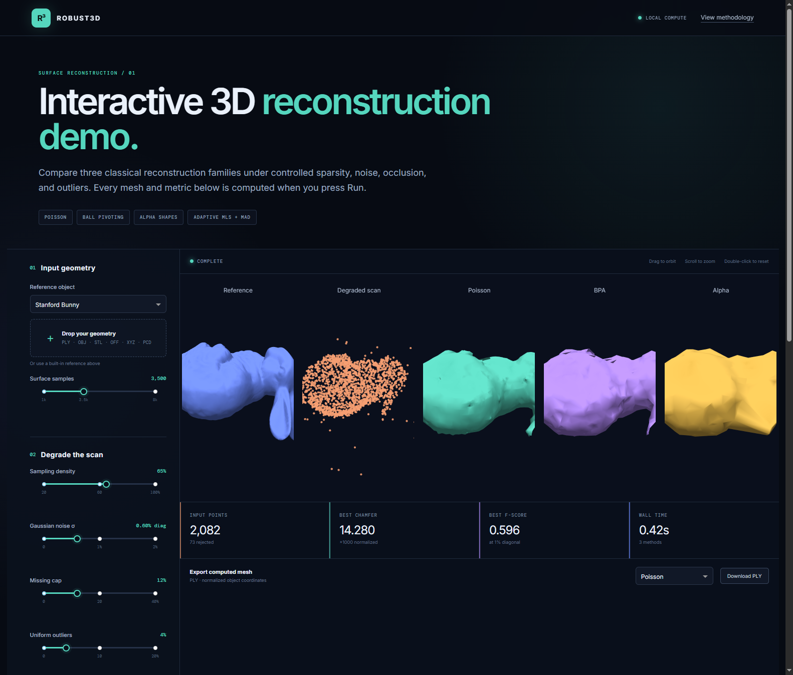
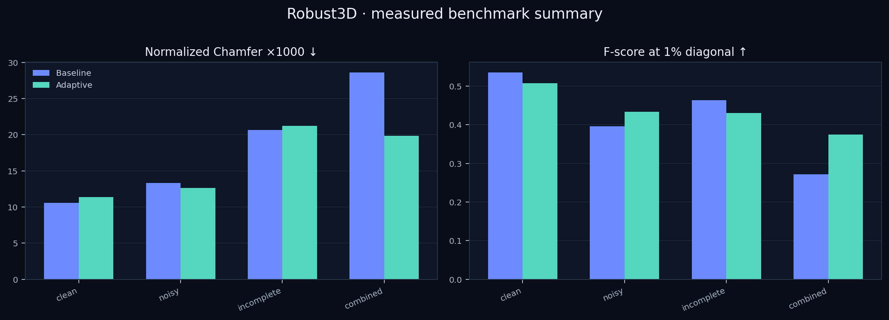
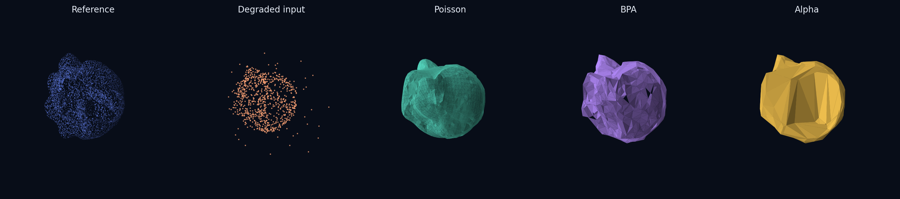
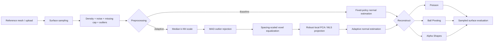

<div align="center">

# Robust3D

### Surface reconstruction from noisy and incomplete point clouds

**Poisson · Ball Pivoting · Alpha Shapes · Density-adaptive preprocessing**

[Interactive lab](#interactive-geometry-lab) · [Measured results](#measured-results) · [Reproduce](#reproduce-the-benchmark) · [Technical notes](docs/ALGORITHMS.md)

</div>



Robust3D is an end-to-end classical geometry processing project for asking a practical question: **what happens to surface reconstruction when a scan is sparse, noisy, occluded, or contaminated by outliers?** It provides a tested Python package, three reconstruction baselines, a geometry-based adaptive preprocessing method, a batch experiment runner, quantitative surface metrics, exported meshes, and an interactive Plotly/Dash laboratory.

There is no neural network and no hardcoded demo output. The dashboard, CLI, CSV files, figures, and report all call the same implementation in `src/robust3d`.

## Measured results

The committed quick benchmark contains **48 successful reconstruction runs**: 2 objects × 4 scan conditions × 2 preprocessing modes × 3 algorithms. It was regenerated on 26 October 2026 with Python 3.11, Open3D 0.19, 1,800 input samples, a fixed seed of 7, and 2,500 evaluation samples.

On the 12 paired, contamination-heavy cases (noise σ ≥ 0.5% of the object diagonal or nonzero outliers), adaptive preprocessing achieved:

- **7.4% median reduction in normalized Chamfer distance**
- **+0.058 median F-score change** at a 1%-diagonal threshold
- Better Chamfer and F-score in **83% of pairs**

Across all 24 pairs, including clean and missing-only scans, the medians were −2.0% Chamfer reduction and −0.007 F-score. In other words, the adaptive stage is useful when contamination is present, but can mildly oversmooth already-clean data and cannot restore geometry that was never observed. That negative result is part of the project, not hidden.



| Scenario | Preprocessing | Chamfer ×1000 ↓ | F-score @ 1% ↑ | Normal consistency ↑ |
|---|---:|---:|---:|---:|
| Clean | Baseline | 10.587 | 0.536 | 0.942 |
| Clean | Adaptive | 11.369 | 0.507 | 0.930 |
| Noisy | Baseline | 13.338 | 0.396 | 0.888 |
| Noisy | Adaptive | 12.650 | 0.433 | 0.900 |
| Incomplete | Baseline | 20.671 | 0.463 | 0.888 |
| Incomplete | Adaptive | 21.209 | 0.431 | 0.887 |
| Combined | Baseline | 28.611 | 0.271 | 0.772 |
| Combined | Adaptive | 19.823 | 0.375 | 0.846 |

The table aggregates both objects and all three algorithms. Exact per-run numbers, timings, failures, and environment metadata live in [`results/metrics.csv`](results/metrics.csv), [`results/metrics.json`](results/metrics.json), and [`results/REPORT.md`](results/REPORT.md). Values may vary slightly across Open3D builds because metric sampling and parallel Poisson reconstruction can differ.



## Interactive geometry lab

The dashboard is the main project interface. It can:

- switch among Stanford Bunny, Stanford Armadillo, a torus, a trefoil knot, and a sphere;
- upload PLY, OBJ, STL, OFF, XYZ, PTS, or PCD geometry;
- change sampling density, Gaussian noise, a contiguous missing cap, and uniform outliers;
- compare Poisson, BPA, and alpha shapes side by side with linked-style 3D controls;
- toggle baseline versus density-adaptive preprocessing;
- tune Poisson depth, BPA radii, alpha scale, point count, and random seed;
- compute Chamfer distance, F-score, precision/recall, normal consistency, 95th-percentile error, area ratio, topology counts, and runtime;
- export any computed reconstruction as an ASCII PLY mesh.

All work stays on the local machine. The visible progress state and error reporting make expensive or invalid parameter combinations explicit.

### Quick start

```bash
git clone <your-repository-url>
cd Robust3D
python -m venv .venv
```

Activate the environment:

```powershell
# Windows PowerShell
.\.venv\Scripts\Activate.ps1
```

```bash
# macOS / Linux
source .venv/bin/activate
```

Install and launch:

```bash
python -m pip install --upgrade pip
python -m pip install -e ".[dev]"
robust3d demo
```

Open <http://127.0.0.1:8050>. The Stanford meshes are downloaded by Open3D and cached on first use; Robust3D does not redistribute them.

## Pipeline



The proposed preprocessing is deliberately classical and interpretable. Its distance thresholds are expressed in units of the measured local sample spacing, rather than in arbitrary object coordinates. A median-absolute-deviation rule rejects isolated points, voxel downsampling reduces density imbalance, one conservative local PCA projection suppresses normal-direction noise, and a spacing-scaled radius stabilizes oriented normal estimation.

Read [`docs/ALGORITHMS.md`](docs/ALGORITHMS.md) for the algorithmic reasoning and [`docs/EXPERIMENTS.md`](docs/EXPERIMENTS.md) for the protocol.

## Command-line use

List the built-in objects:

```bash
robust3d datasets
```

Reconstruct a degraded Stanford Bunny:

```bash
robust3d reconstruct \
  --dataset bunny \
  --algorithm poisson \
  --preprocessing adaptive \
  --points 5000 \
  --density 0.55 \
  --noise 0.008 \
  --missing 0.18 \
  --outliers 0.08 \
  --output results/meshes/bunny_poisson.ply
```

Use an uploaded mesh or point cloud:

```bash
robust3d reconstruct --input scan.ply --algorithm bpa --output reconstruction.ply
```

Python API:

```python
from robust3d import (
    DegradationConfig,
    PipelineConfig,
    PreprocessConfig,
    ReconstructionConfig,
    run_pipeline,
)

result = run_pipeline(PipelineConfig(
    object_name="bunny",
    n_points=3500,
    degradation=DegradationConfig(
        density=0.55, noise_sigma=0.008,
        missing_fraction=0.18, outlier_fraction=0.08, seed=7,
    ),
    preprocessing=PreprocessConfig(mode="adaptive"),
    reconstruction=ReconstructionConfig(algorithm="poisson", poisson_depth=7),
))

print(result.metrics)
```

## Reproduce the benchmark

The quick benchmark is suitable for CI and laptops:

```bash
robust3d experiment --config configs/quick.yaml --output results
```

The larger sweep uses three objects, seven degradation scenarios, 5,000 source samples, 10,000 evaluation samples, and Poisson depth 8:

```bash
robust3d experiment --config configs/full.yaml --output results/full
```

Each run writes raw CSV/JSON, environment metadata, a Markdown report, charts, representative PLY meshes, and a comparison image. Failed algorithm/parameter combinations are recorded rather than silently discarded.

## Metrics

- **Chamfer ×1000:** mean of the two directional, unsquared nearest-surface distances, divided by the clean reference bounding-box diagonal and multiplied by 1000.
- **F-score @ 1%:** harmonic mean of reconstructed-surface precision and reference-surface recall within 1% of that diagonal.
- **Normal consistency:** symmetric mean absolute dot product between nearest sampled surface normals.
- **H95 ×1000:** 95th percentile of the combined directional distances, normalized by the diagonal.
- **Area ratio / watertightness / counts:** useful diagnostic properties, not direct accuracy measures.
- **Runtime:** wall-clock reconstruction time; preparation is recorded separately to avoid charging shared preprocessing to every method.

The reconstruction and reference meshes are independently sampled for evaluation. See the exact definitions in [`src/robust3d/evaluation.py`](src/robust3d/evaluation.py).

## Repository map

```text
Robust3D/
├── app.py                       # dashboard entry point
├── configs/                     # quick and full benchmark protocols
├── docs/                        # algorithms, datasets, experiment design
├── results/                     # real committed outputs and raw metrics
├── scripts/run_experiments.py   # convenience benchmark entry point
├── src/robust3d/
│   ├── datasets.py              # Stanford/procedural references + sampling
│   ├── degradation.py           # controlled scan corruptions
│   ├── preprocessing.py         # baseline + proposed adaptive method
│   ├── reconstruction.py        # Poisson, BPA, alpha shapes
│   ├── evaluation.py            # surface metrics
│   ├── pipeline.py              # shared orchestration
│   ├── visualization.py         # live and static graphics
│   ├── dashboard.py             # functional Dash app
│   ├── assets/style.css         # responsive scientific UI
│   └── cli.py                   # reproducible CLI
└── tests/                       # deterministic unit + integration tests
```

## Verification

```bash
python -m pytest
python -m ruff check .
```

The current suite exercises deterministic degradation, scale estimation, adaptive outlier rejection, all three real reconstructors, metric bounds, and the dashboard HTTP entry point.

## Limitations

- Poisson can produce visually plausible closure over missing regions; this is not evidence that the hidden surface is correct.
- BPA depends on normal orientation and radius choice; very sparse or uneven scans may leave holes.
- Alpha shapes are sensitive to alpha and can become coarse or fragmented.
- The adaptive stage targets noise and isolated outliers. It is intentionally bypassable because it can oversmooth clean high-frequency detail.
- Uploads that contain only points have no ground-truth surface, so reference-based metrics are marked unavailable.
- The benchmark is a controlled undergraduate study, not a claim of state-of-the-art reconstruction.

## Data and references

Stanford Bunny and Armadillo are fetched from the [Stanford 3D Scanning Repository](https://graphics.stanford.edu/data/3Dscanrep/) through Open3D's data helper. Procedural objects provide license-safe topology stress tests. No dataset files are committed; review each source's terms before redistribution. See [`docs/DATASETS.md`](docs/DATASETS.md).

Core methods:

1. M. Kazhdan, M. Bolitho, and H. Hoppe, “Poisson Surface Reconstruction,” SGP 2006.
2. F. Bernardini et al., “The Ball-Pivoting Algorithm for Surface Reconstruction,” IEEE TVCG, 1999.
3. H. Edelsbrunner and E. P. Mücke, “Three-Dimensional Alpha Shapes,” ACM TOG, 1994.

## License

Project code is released under the [MIT License](LICENSE). Third-party datasets retain their original terms.
